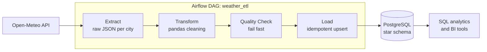
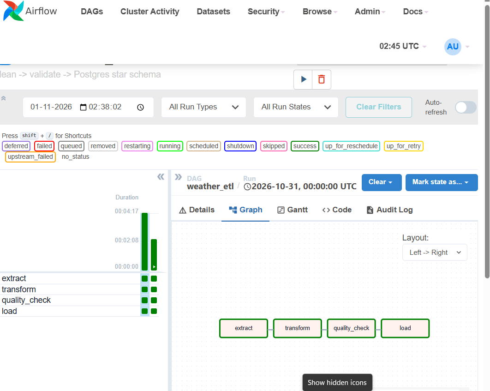
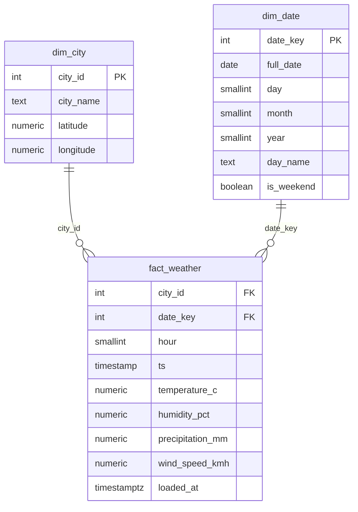
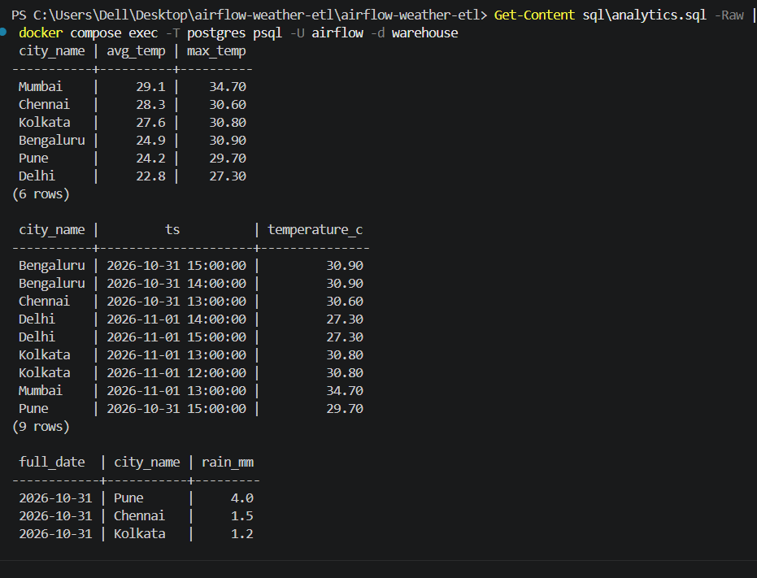
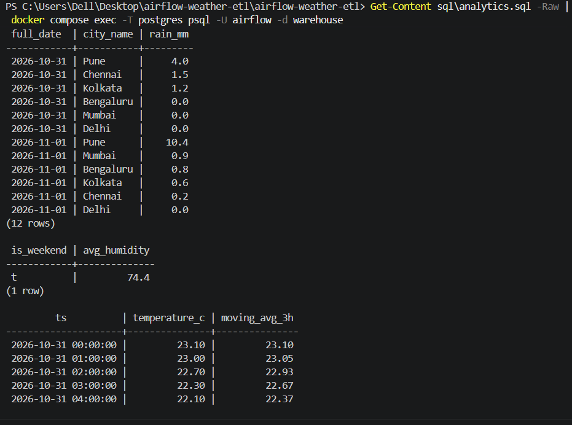
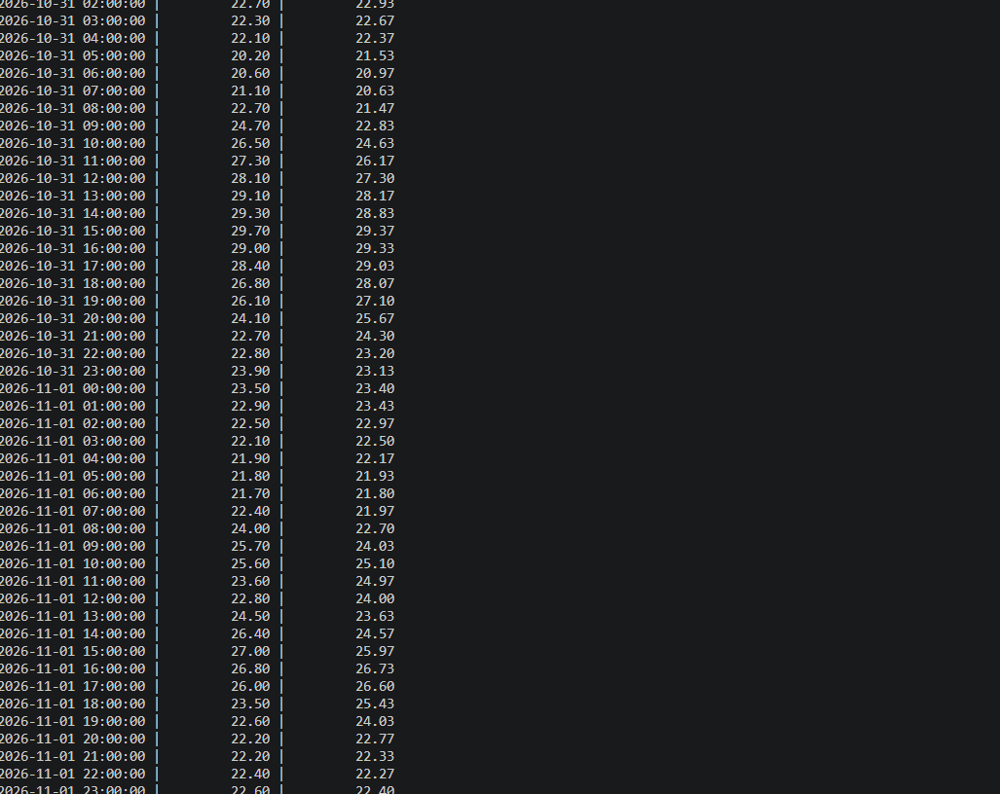

# 🌦️ Weather ETL Pipeline


A production-style, end-to-end **data engineering pipeline** that collects hourly weather data for six Indian cities, cleans and validates it, and loads it into a **star-schema data warehouse** on PostgreSQL. It is orchestrated by **Apache Airflow** and runs fully in **Docker** with a single command.

---

## 📌 Table of Contents
- [Overview](#-overview)
- [Architecture](#-architecture)
- [Tech Stack](#-tech-stack)
- [Data Model](#-data-model)
- [Pipeline Tasks](#-pipeline-tasks)
- [Data Quality Checks](#-data-quality-checks)
- [Getting Started](#-getting-started)
- [Example Analytics](#-example-analytics)
- [Running Tests](#-running-tests)
- [Project Structure](#-project-structure)
- [Design Decisions](#-design-decisions)
- [Troubleshooting](#-troubleshooting)
- [Future Improvements](#-future-improvements)
- [Author](#-author)

---

## 🔎 Overview

| | |
|---|---|
| **Source** | [Open-Meteo API](https://open-meteo.com/) (free, no API key) |
| **Cities** | Pune, Mumbai, Delhi, Bengaluru, Chennai, Kolkata |
| **Metrics** | Temperature (°C), humidity (%), precipitation (mm), wind speed (km/h) |
| **Granularity** | Hourly, one run per day |
| **Schedule** | `@daily` with 2 automatic retries per task |
| **Warehouse** | PostgreSQL star schema (1 fact table, 2 dimension tables) |

---

## 🏗️ Architecture



### 📸 Airflow Pipeline Run (All Green)


---

## 🧰 Tech Stack

| Layer | Tool |
|---|---|
| Language | Python |
| Processing | pandas |
| Orchestration | Apache Airflow (TaskFlow API) |
| Storage | PostgreSQL |
| Containerisation | Docker, Docker Compose |
| Testing | pytest |

---

## 🗄️ Data Model



The primary key of `fact_weather` is `(city_id, ts)`, so there is exactly one row per city per hour.

---

## ⚙️ Pipeline Tasks

| Task | File | What it does |
|---|---|---|
| `extract` | `src/extract.py` | Calls the API for each city and stores the raw JSON in `data/raw/<date>/` |
| `transform` | `src/transform.py` | Flattens the JSON, converts types, removes duplicates and empty rows, and writes a clean CSV to `data/staging/` |
| `quality_check` | `src/quality.py` | Validates the data and stops the pipeline if anything is wrong |
| `load` | `src/load.py` | Creates tables if needed and upserts dimensions and facts into PostgreSQL |

---

## ✅ Data Quality Checks

The pipeline fails **before** loading if any of these checks fail:

| Check | Rule |
|---|---|
| Not empty | The dataset must contain rows |
| Key columns | No nulls in `city` or `ts` |
| Uniqueness | No duplicate `(city, ts)` pairs |
| Temperature | Between -50 °C and 60 °C |
| Humidity | Between 0 and 100 % |
| Precipitation | Never negative |
| Completeness | No metric column has more than 20 % nulls |

---

## 🚀 Getting Started

### Prerequisites
- [Docker Desktop](https://www.docker.com/products/docker-desktop/) (with Docker Compose)
- Git

### 1. Clone and start

```bash
git clone https://github.com/Trusha25/airflow-weather-etl.git
cd airflow-weather-etl
docker compose up -d
```

The first start takes a minute or two while Airflow initialises its database.

### 2. Run the pipeline
1. Open **http://localhost:8080** and sign in with username `admin` and password `admin`.
2. Switch on the **`weather_etl`** DAG.
3. Click **Trigger DAG** (the play button) and watch the four tasks turn green.

### 3. Query the warehouse

```bash
docker compose exec -T postgres psql -U airflow -d warehouse < sql/analytics.sql
```

Or connect with any SQL client: host `localhost`, port `5433`, database `warehouse`, user `airflow`, password `airflow`.

### 4. Stop everything

```bash
docker compose down        # keep the data
docker compose down -v     # also delete the database volume
```

---

## 📊 Example Analytics

`sql/analytics.sql` contains ready-made queries, including:

1. Average and maximum temperature by city
2. Hottest hour per city (window function with `RANK()`)
3. Daily rainfall per city
4. Weekday vs weekend humidity
5. 3-hour moving average temperature (window frame)

```sql
-- Hottest hour for each city
SELECT city_name, ts, temperature_c FROM (
  SELECT c.city_name, f.ts, f.temperature_c,
         RANK() OVER (PARTITION BY c.city_name ORDER BY f.temperature_c DESC) AS rnk
  FROM fact_weather f JOIN dim_city c USING (city_id)
) t WHERE rnk = 1;
```

### 📸 Warehouse Query Results

#### 1. Temperature Rankings, Hottest Hour (`RANK()`), & Rainfall:


#### 2. Rainfall Summary, Weekend vs Weekday Humidity, & Moving Average:


#### 3. 3-Hour Moving Average Time-Series:


---

## 🧪 Running Tests

```bash
python -m venv .venv
source .venv/bin/activate        # Windows: .venv\Scripts\activate
pip install -r requirements.txt
pytest
```

The tests cover the transform step (shape, de-duplication, empty handling) and data-quality rules (clean data passes; bad temperature, humidity, negative precipitation, null keys, and missing columns are caught).

---

## 📁 Project Structure

```
airflow-weather-etl/
├── dags/
│   └── weather_etl_dag.py     # Airflow DAG definition
├── src/
│   ├── config.py              # Cities, API settings, DB connection
│   ├── extract.py             # API → raw JSON
│   ├── transform.py           # Cleaning with pandas
│   ├── quality.py             # Data-quality checks
│   └── load.py                # Upsert into PostgreSQL
├── sql/
│   ├── schema.sql             # Table definitions
│   └── analytics.sql          # Example analytical queries
├── tests/
│   └── test_pipeline.py       # Unit tests
├── docker/
│   └── postgres-init.sql      # Creates the warehouse database
├── scripts/
│   └── start.sh               # Airflow startup script
├── docs/                      # Screenshots (dag.png, query1.png, query2.png, query3.png)
├── data/                      # Raw and staging files (git-ignored)
├── docker-compose.yml
├── requirements.txt
└── README.md
```

---

## 🧠 Design Decisions

- **Idempotent loads.** The fact table uses `INSERT ... ON CONFLICT DO UPDATE`, so re-running a day never creates duplicates.
- **Star schema.** Separating facts from city and date dimensions keeps analytical queries simple and fast.
- **Fail fast on bad data.** A dedicated quality task blocks the load instead of silently storing wrong values.
- **Raw data is kept.** Storing the original JSON allows any run to be replayed or audited.
- **Thin DAG, logic in `src/`.** The DAG only orchestrates, so the business logic can be unit-tested without Airflow.
- **Retries.** Transient API failures are retried automatically (2 retries, 2 minutes apart).

---

## 🛠️ Troubleshooting

| Problem | Fix |
|---|---|
| Airflow page does not load | Wait a minute, then check `docker compose logs airflow-webserver` |
| `start.sh` fails on Windows | Make sure the file uses LF line endings (the repo's `.gitattributes` handles this on a fresh clone) |
| Port 8080 or 5433 is already in use | Change the left-hand port number in `docker-compose.yml` |
| `extract` task fails | Check your internet connection and read the task log in the Airflow UI |
| Want a clean slate | `docker compose down -v` and start again |

---

## 🔮 Future Improvements

- [ ] Add **dbt** models for a cleaner analytics layer
- [ ] Add failure alerts through Slack or email (`on_failure_callback`)
- [ ] Build a **Tableau / Streamlit** dashboard on top of the warehouse
- [ ] Add CI with **GitHub Actions** (lint and tests on every push)
- [ ] Backfill historical data with Airflow `catchup`
- [ ] Deploy on a cloud VM

---

## 👩‍💻 Author

**Trusha Jadhav**
Aspiring Data Engineer

- GitHub: [@Trusha25](https://github.com/Trusha25)
- LinkedIn: _add your profile link here_

⭐ If you found this project useful, consider giving it a star.
